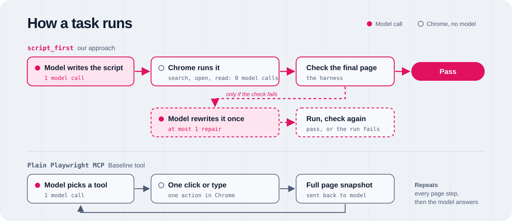

<a href="https://computer-use-optimisation.vercel.app">
  
</a>

<p align="center">
  <a href="https://computer-use-optimisation.vercel.app"><b>Open the live site</b></a>
  &nbsp;&nbsp;&nbsp;
  <a href="https://github.com/advcode118/alexs-computeruseoptimisation">GitHub</a>
  &nbsp;&nbsp;&nbsp;
  <a href="https://cursor.com/codebase/tom-wei-de-vrieze/alexs-computeruseoptimisation">Cursor Origin</a>
</p>

# Alex's browser tool

Computer use is slow because the model stops and thinks before every click. **script_first** doesn't. One Claude call writes a Playwright script for the whole task, Chrome runs it start to finish, and Claude only comes back if the final page is wrong.

## How it works



1. **Claude writes the script.** One call, for the whole task, not one click at a time.
2. **Chrome runs it.** Search, open, read. No model call between actions.
3. **Check, repair once.** If the end-state check fails, Claude sees the failure and rewrites the script once.

Plain Playwright MCP and Stagehand are the baselines it races.

## Latest numbers: paired live run, 18 Nov 2026

**Our own interactive recovery is not good enough yet.** Per task it is the fastest and cheapest arm, but it passes 4 of 18 tasks against 11 for browser-use alone, so per *successful* task it is slower and more expensive. Our script stage with browser-use as the recovery stage matches browser-use alone on accuracy (within noise) while being faster and cheaper per task and per pass. browser-use stays a benchmark, so the next work is making our own recovery stage good enough to replace it.

18 fresh external tasks (`extval`, pre-registered, never seen by any model before the run), `gpt-6.1-sol` at medium effort, 1 run per arm, graded with scorer v2. Plan: [`paired_run_plan.md`](docs/results/paired_run_plan.md). Raw rows and details: [`docs/results/paired_run_20261118/`](docs/results/paired_run_20261118/).

| Arm | Passed | Model calls mean / p90 | Wall mean / p90 | $ per task | Wall per pass | $ per pass |
| :-- | :-: | --: | --: | --: | --: | --: |
| Script stage → **our interactive stage** | 4/18 | 4.3 / 6 | **21.7s** / 32.9s | **$0.041** | 97.7s | $0.185 |
| Script stage → browser-use (benchmark) | **12/18** | 8.9 / 24 | 41.1s / 85.4s | $0.067 | **61.7s** | **$0.101** |
| browser-use alone, ultrafast | 11/18 | 9.7 / 17 | 57.8s / 141.7s | $0.072 | 94.5s | $0.117 |

Our interactive stage ran on 14 tasks and recovered 1. browser-use as recovery ran on 15 and recovered 10. One run of 18 tasks cannot separate differences of a task or two. Total spend $3.42 of a $5 cap.

Pass rates are approximate: a blind labeller agreed with the scorer on only 36 of 54 rows, mostly the scorer being too strict on the browser-use arms. Counting the labeller's "correct" instead gives 6/18, 12/18 and 13/18, so the conclusion is the same.

### Older numbers (superseded)

PR #18 probe on Claude Sonnet 5.5. Three tuned tasks (Wikipedia search, Python docs, Hacker News top), scored on wall time per successful task. Kept for history only. Re-graded results for other sets are in [`docs/TEST_RESULTS.md`](docs/TEST_RESULTS.md).

| | Passed | Per success | Per run |
| :-- | :-: | --: | --: |
| **script_first** (Alex's tool) | **3/3** | **3.67s** | **$0.047** |
| Plain Playwright MCP | 3/3 | 2.98s | $0.165 |
| Stagehand | 3/3 | 4.62s | $0.074 |

Same pass rate as Playwright MCP at about 3.5x less cost per run, and about 0.7s behind it on time. Every script_first task is still 2 steps. Claude spend so far is about $16.64 of the $50 budget.

## Done, and next

- [x] A browser loop that owns each step, and an M0 measurement that showed the outer model's thinking is the clock (87% of the time).
- [x] The speed-layer stack, PRs #7 to #17: an MCP proxy, settle, compact diffs, macros, and replay. Plain Playwright MCP stayed faster, so that stack is **parked**.
- [x] script_first (PR #16), one repair call that reaches 3/3 (PR #17), and the PR #18 probe above.
- [x] Our own interactive recovery stage (PR #110), scorer v2 (PR #109), and a pre-registered paired live run against browser-use (above).
- [ ] **Make the interactive stage recover tasks.** In the live run it recovered 1 of 14. Two causes: it must prove its answer on the page it ends on, so it fails answers that combine two pages; and its page reads compete with the 4-call budget.

<details>
<summary><b>Working on this repo</b></summary>

<br>

The progress site is a Next.js App Router app with Tailwind. All of the copy and every probe number lives in [`data/progress.ts`](https://github.com/advcode118/alexs-computeruseoptimisation/blob/cursor/progress-site-redesign-8676/data/progress.ts) on the `cursor/progress-site-redesign-8676` branch. Edit that file to update the site, and only add numbers that were measured.

The benchmark harness is separate from the site: see [`bench/README.md`](bench/README.md).

**Run locally** (Node.js 20 or newer):

```bash
npm install
npm run dev        # http://localhost:3000
npm run build && npm start   # production build
```

**Deploy.** There are no environment variables and no custom output directory. Deploy from a checkout with the Vercel CLI, signed in to Tom's Vercel account:

```bash
npx vercel          # preview
npx vercel --prod   # production
```

**Remotes.** The main remote is Cursor Origin. GitHub is a mirror at `advcode118/alexs-computeruseoptimisation`.

</details>
