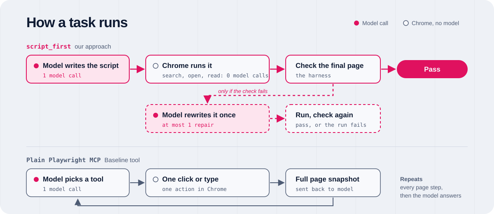

<a href="https://computer-use-optimisation.vercel.app">
  
</a>

<p align="center">
  <a href="https://computer-use-optimisation.vercel.app"><b>Open the live site</b></a>
  &nbsp;&nbsp;&nbsp;
  <a href="https://github.com/advcode118/alexs-computeruseoptimisation">GitHub</a>
  &nbsp;&nbsp;&nbsp;
  <a href="https://github.com/advcode118/alexs-computeruseoptimisation">Cursor Origin</a>
</p>

# Alex's browser tool

Computer use is slow because the model stops and thinks before every click. **script_first** doesn't. One Claude call writes a Playwright script for the whole task, Chrome runs it start to finish, and Claude only comes back if the final page is wrong.

## How it works



1. **Claude writes the script.** One call, for the whole task, not one click at a time.
2. **Chrome runs it.** Search, open, read. No model call between actions.
3. **Check, repair once.** If the end-state check fails, Claude sees the failure and rewrites the script once.

Plain Playwright MCP and Stagehand are the baselines it races.

## Latest numbers

PR #18 probe on Claude Sonnet 5.5. Three tasks: Wikipedia search, Python docs, Hacker News top. Scored on wall time per successful task.

| | Passed | Per success | Per run |
| :-- | :-: | --: | --: |
| **script_first** (Alex's tool) | **3/3** | **3.67s** | **$0.047** |
| Plain Playwright MCP | 3/3 | 2.98s | $0.165 |
| Stagehand | 3/3 | 4.62s | $0.074 |

Same pass rate as Playwright MCP at about 3.5x less cost per run, and about 0.7s behind it on time. Every script_first task is still 2 steps. Claude spend so far is about $16.64 of the $50 budget.

## Done, and next

- [x] A browser loop that owns each step, and an M0 measurement that showed the outer model's thinking is the clock (87% of the time).
- [x] The speed-layer stack, PRs #7 to #17: an MCP proxy, settle, compact diffs, macros, and replay. Plain Playwright MCP stayed faster, so that stack is **parked**.
- [x] script_first (PR #16), one repair call that reaches 3/3 (PR #17), and the PR #18 probe above.
- [ ] **PR #20: stop when the first page is already done.** In progress, not yet measured.

<details>
<summary><b>Working on this repo</b></summary>

<br>

The progress site is a Next.js App Router app with Tailwind. All of the copy and every probe number lives in [`data/progress.ts`](https://github.com/advcode118/alexs-computeruseoptimisation/blob/cursor/progress-site-redesign-8676/data/progress.ts) on the `cursor/progress-site-redesign-8676` branch. Edit that file to update the site, and only add numbers that were measured.

The browser loop is separate from the site: `python -m loop demo` (see [`loop/README.md`](https://github.com/advcode118/alexs-computeruseoptimisation/blob/cursor/progress-site-redesign-8676/loop/README.md)).

**Run locally** (Node.js 20 or newer):

```bash
npm install
npm run dev        # http://localhost:3000
npm run build && npm start   # production build
```

**Deploy.** There are no environment variables and no custom output directory. Deploy from a checkout with the Vercel CLI, signed in to Tom's Vercel account:

```bash
npx vercel          # preview
npx vercel --prod   # production
```

**Remotes.** The main remote is Cursor Origin. GitHub is a mirror at `advcode118/alexs-computeruseoptimisation`.

</details>
